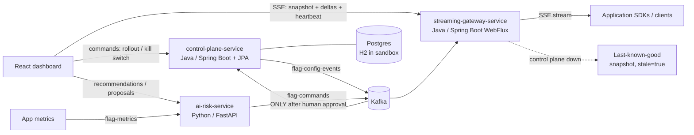

# Distributed Feature Flag and Release Control Platform

A LaunchDarkly-style feature-flag platform built by **Akshay K**: flag
configuration is distributed to application instances, evaluated locally at
low latency, rolled out gradually, kill-switched instantly, and guarded by
an **AI release-risk agent** that recommends rollout / hold / rollback — but
can only act through a human-approved, audit-logged proposal.

This repo contains two generations:

- **v1 (repo root)** — Python 3.12 stdlib-only reference implementation
  (REST control plane, polling SDK, dashboard). Still runnable, 32 tests.
- **v2 Enterprise (`enterprise/`)** — microservices: Java 21 / Spring Boot
  control plane + streaming gateway, Python FastAPI AI service, React
  dashboard, **streaming-first** config propagation (Kafka topics + SSE
  instead of REST polling). See `TEST_RESULTS.md` for sandbox test evidence.

## Enterprise v2 architecture



| Service | Stack | Responsibility |
|---|---|---|
| `enterprise/flag-common` | Java 21 library | Domain model, SHA-256 stable bucketing, evaluation engine |
| `enterprise/control-plane-service` | Java, Spring Boot MVC + Spring Data JPA | Flag CRUD, monotonic versioning, history, audit, rollback; publishes config events |
| `enterprise/streaming-gateway-service` | Java, Spring Boot WebFlux | Consumes config events; SSE streaming to clients; last-known-good HA |
| `enterprise/ai-risk-service` | Python, FastAPI | Metrics analysis, explainable recommendations, guarded proposals -> command events |
| `enterprise/frontend` | React 18 + Vite | Live dashboard on the SSE stream, command controls, risk panel, audit view |
| `enterprise/infra` | Compose / K8s / Prometheus | Postgres, Kafka, Redis, service manifests, scrape config |

## Quick start

### Enterprise v2 with Docker Compose (production-shaped)

```bash
cd enterprise/infra
docker compose up --build
# Dashboard http://localhost:5173 · Control plane http://localhost:8080
# Gateway SSE http://localhost:8081/stream/config · AI service http://localhost:8090/health
```

### Enterprise v2 sandbox profile (no Docker/Kafka needed)

```bash
export JAVA_HOME=~/workspace/tools/jdk21   # or your own JDK 21
mvn -f enterprise/pom.xml test            # Java suites (offline after first dependency fetch)
cd enterprise/control-plane-service && mvn spring-boot:run   # :8080 (H2, in-process event bus + internal SSE feed)
cd enterprise/streaming-gateway-service && mvn spring-boot:run  # :8081 (subscribes to the feed, re-streams SSE)
cd enterprise/ai-risk-service && uvicorn app:app --port 8090    # Python AI service
cd enterprise/frontend && npm install && npm run dev            # React dashboard :5173
```

### v1 reference implementation

```bash
python3 -m featureflags.server --port 8080   # v1 control plane + dashboard
python3 demo.py                              # scripted end-to-end story
python3 -m unittest discover -s tests        # 32 tests
```

**Demo API key (v1 only)**: `demo-api-key-12345` as the `x-api-key` header —
a documented demo credential, not a real secret.

## Design highlights

- **Low-latency evaluation**: pure function of (flag, user); SDKs evaluate
  locally, no network on the hot path (v1 SDK; v2 clients consume the stream).
- **Streaming propagation**: every mutation becomes a `flag-config-events`
  event (Kafka in prod; in-process bus + internal SSE feed in sandbox). The
  gateway streams snapshot -> deltas -> heartbeats over SSE. No polling.
- **Stable hashing**: SHA-256(`flagKey.salt.userKey`) -> bucket 0..9999;
  inclusion is `bucket < pct x 100`, so raising a rollout never drops a user.
- **Versioning & audit**: versions only move forward; rollback restores an
  old snapshot *as a new version*; every change (human or approved AI
  proposal) is audit-logged with actor and old/new values.
- **Guarded AI execution**: the risk agent creates proposals with one-time
  approval tokens. Approval emits a `flag-commands` event; the agent never
  writes flag state directly. Increases are capped at +25% per approval.

See `docs/system-design.md` for the deep dive and `TEST_RESULTS.md` for
measured test evidence.
